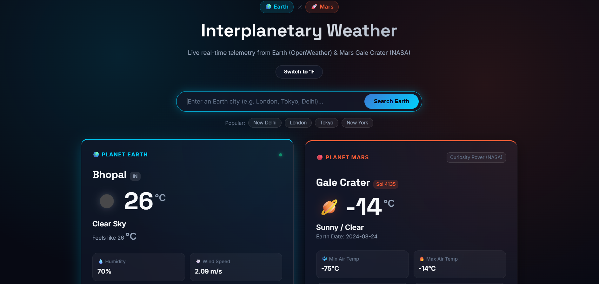
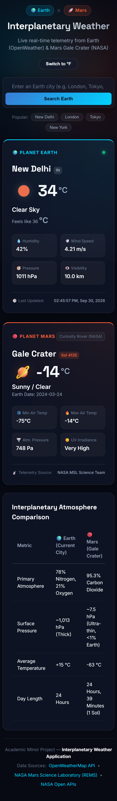
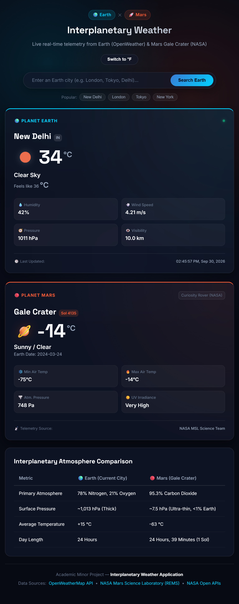
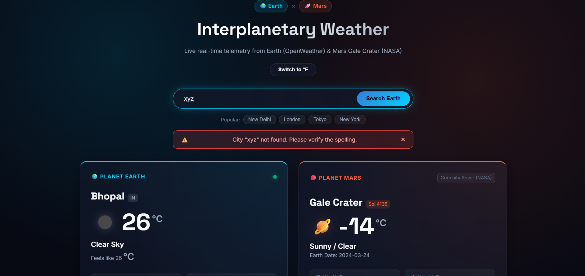
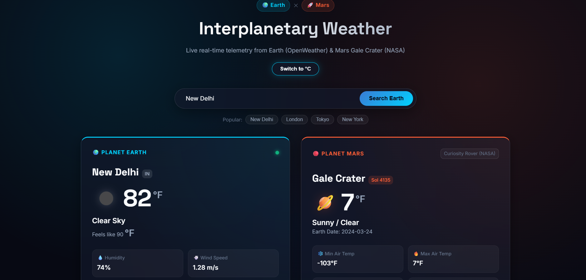

# 🪐 Interplanetary Weather — Earth & Mars Dashboard

> **Arithmetrix Virtual Internship Program (AVIP 2026) — Minor Project**  
> An interplanetary telemetry web application delivering synchronized real-time atmospheric data from **Planet Earth** and **Planet Mars (Gale Crater)**.

---

## 🌟 Overview

The **Interplanetary Weather App** is a responsive web dashboard designed to bridge terrestrial and extra-terrestrial meteorology. It simultaneously connects to the **OpenWeatherMap API** to fetch live city-level weather conditions on Earth and the **NASA Mars Science Laboratory API / InSight feed** to display live telemetry from the Curiosity rover operating inside Mars' Gale Crater.

---

## 📸 Application Screenshots

### 1. Interplanetary Weather Dashboard (Earth & Mars Synchronized)

### 2. Responsive Breakpoint Previews

| Mobile View | Tablet View |
| :---: | :---: |
|  |  |

### 3. User Feedback for Invalid City Input (Error Handling)

### 4. Dual-Planet Temperature Unit Switcher (°F Mode)

---

## ✨ Features (AVIP Requirements)

- **🌍 Earth Weather Telemetry**:
  - Accepts any valid global city input (e.g. *New Delhi, London, Tokyo, New York*).
  - Displays current temperature, feels-like temperature, humidity %, atmospheric pressure, wind speed, and visibility.
  - Renders official OpenWeather condition icons and textual descriptions.
- **🕒 Live Update Timestamp**:
  - Displays the exact timestamp of the last data update from OpenWeather.
- **⚠️ Robust Error & Input Handling**:
  - Handles unknown or misspelled city inputs gracefully with HTTP 404 interception.
  - Displays an accessible, animated error banner with clear user feedback without crashing the application.
- **🔴 NASA Mars Weather Integration**:
  - Fetches real telemetry from NASA's Curiosity Rover (REMS instrument at Gale Crater).
  - Displays Martian Sol number, Earth date, High & Low air temperatures, atmospheric opacity (sky clarity), and surface pressure.
  - Includes offline telemetry fallback to ensure continuous availability even behind campus/corporate firewalls.
- **🔄 Dual-Planet Unit Toggle**:
  - Dynamically converts all temperatures on both Earth and Mars between **Celsius (°C)** and **Fahrenheit (°F)** using client-side caching without redundant API calls.
- **🪐 Interplanetary Comparison Matrix**:
  - A side-by-side analytical comparison of atmospheric composition, pressure, surface temperatures, and day lengths between both planets.

---

## 📡 API Sources & References

This project utilizes real-world telemetry from the following developer portals:

| Planet | Provider | Endpoint & Documentation | Authentication |
| :--- | :--- | :--- | :--- |
| **Earth** | **OpenWeatherMap** | [OpenWeather Current Weather API](https://openweathermap.org/current) | Free API Key via ppid |
| **Mars** | **NASA MSL / JPL** | [NASA Mars Science Laboratory REMS Feed](https://mars.nasa.gov/rss/api/?feed=weather&category=msl&feedtype=json) | Public Open Feed |
| **Mars** | **NASA Open APIs** | [NASA InSight Weather Service API](https://api.nasa.gov/) | Free API Key (pi.nasa.gov) |

---

## 📊 Sample API Responses

### 1. OpenWeatherMap API — Sample Response (/weather?q=New Delhi)
`json
{
  coord: { lon: 77.2167, lat: 28.6667 },
  weather: [
    {
      id: 800,
      main: Clear,
      description: clear sky,
      icon: 01d
    }
  ],
  base: stations,
  main: {
    temp: 28.05,
    feels_like: 28.72,
    temp_min: 28.05,
    temp_max: 28.05,
    pressure: 1012,
    humidity: 55
  },
  visibility: 10000,
  wind: { speed: 3.6, deg: 290 },
  clouds: { all: 0 },
  dt: 1727620800,
  sys: {
    type: 1,
    id: 9165,
    country: IN,
    sunrise: 1727570412,
    sunset: 1727613654
  },
  timezone: 19800,
  id: 1261481,
  name: New Delhi,
  cod: 200
}
`

---

### 2. NASA Curiosity Rover REMS Feed — Sample Response (category=msl)
`json
{
  descriptions: {
    sol: Current Martian Sol (Solar Day),
    terrestrial_date: Corresponding Earth Calendar Date,
    min_temp: Minimum Air Temperature in Celsius,
    max_temp: Maximum Air Temperature in Celsius,
    pressure: Atmospheric Surface Pressure in Pascals
  },
  soles: [
    {
      id: 3580,
      terrestrial_date: 2024-03-24,
      sol: 4135,
      ls: 158,
      season: Month 6,
      min_temp: -75,
      max_temp: -14,
      pressure: 748,
      pressure_string: Lower,
      abs_humidity: --,
      wind_speed: --,
      wind_direction: --,
      atmo_opacity: Sunny / Clear,
      sunrise: 05:27,
      sunset: 17:21,
      local_uv_irradiance_index: Very_High,
      min_gts_temp: -81,
      max_gts_temp: 7
    }
  ]
}
`

---

## 📁 Project Structure

`	ext
WD_3_WeatherApp_byte/
│
├── index.html        # Semantic HTML5 layout (Header, Earth & Mars Cards, Comparison)
├── style.css         # Cosmic Glassmorphism styling, animations & responsive media queries
├── config.js         # API credentials, endpoints, and fallback telemetry constants
├── README.md         # Project documentation, sample API responses & screenshots
│
├── js/
│   └── main.js       # Asynchronous API fetching, DOM updates, unit toggle, error handling
│
└── screenshots/
    ├── dashboard.png          # Main UI with Earth & Mars side-by-side
    ├── error_handling.png     # Validation feedback for invalid city
    ├── fahrenheit_mode.png    # Dynamic °C to °F temperature conversion
    ├── mobile_responsive.png  # Mobile layout preview
    └── tablet_responsive.png  # Tablet layout preview
`

---

## 🚀 Getting Started & Setup

### 1. Clone or Download
Download or clone this repository to your local machine:
`ash
git clone https://github.com/YOUR_USERNAME/WD_3_WeatherApp_byte.git
`

### 2. Configure Your API Keys
Open config.js and paste your free API keys into the respective fields:
`javascript
const CONFIG = {
  OPENWEATHER_API_KEY: YOUR_OPENWEATHER_KEY_HERE,
  NASA_API_KEY: YOUR_NASA_KEY_HERE,
  DEFAULT_CITY: New Delhi,
  // ...
};
`
* **Get OpenWeather Key**: Register for free at [openweathermap.org](https://openweathermap.org/api).
* **Get NASA Key**: Register for free at [api.nasa.gov](https://api.nasa.gov/).

### 3. Launch the Application
Simply double-click index.html or open it with the VS Code **Live Server** extension. No node packages, builds, or server installations are required!

---

## 🛠️ Technology Stack

- **Markup**: Semantic HTML5 with accessible ARIA attributes
- **Styling**: Modern CSS3 (CSS Variables, Flexbox, CSS Grid, Glassmorphism ackdrop-filter, Keyframe animations)
- **Scripting**: Vanilla JavaScript (ES6+ sync/await, Fetch API, Promises, DOM Manipulation, State Caching)

---

## 👨‍💻 Author

- **Intern/Student**: Harsha Thakur
- **Program**: Arithmetrix Virtual Internship Program (AVIP 2026)
- **Track**: Web Development & API Integration
